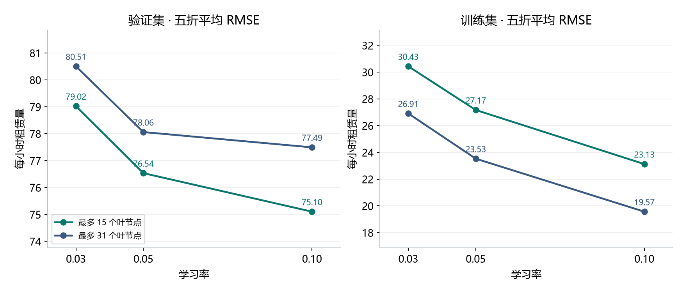
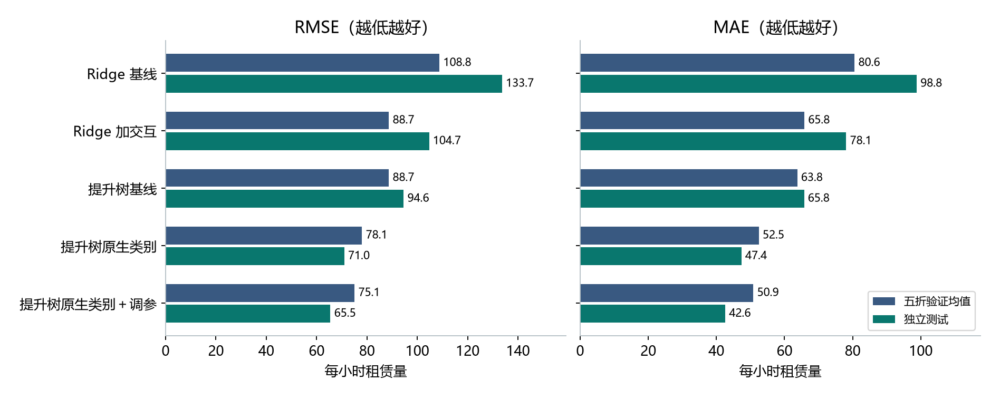
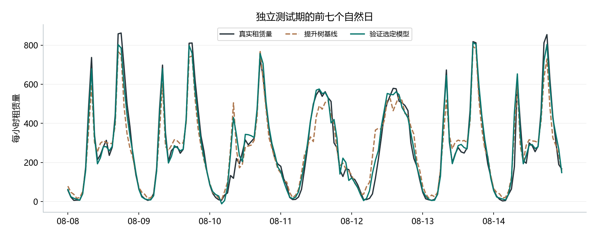

# 课堂 Pre｜共享单车每小时需求预测

**最终模型是使用原生类别特征的直方图梯度提升树。** 先用五折时间验证选定学习率 0.10、最多 15 个叶节点、200 轮，再用全部 13,915 条开发记录训练。独立测试期共 3,464 小时，最终模型平均每小时预测偏差的绝对值为 **42.63 辆次**。

## 建议讲的三条结论

1. **同一个小时，工作日和非工作日的需求曲线不同。** 给 Ridge 增加“小时 × 工作日”类别，让两类日期可以有不同的小时效应。五折平均 RMSE 从 108.84 降到 88.73；单看验证期早上 8 点，MAE 从 192.30 降到 100.77。
2. **提升树的主要收益来自类别处理。** 原生类别分裂可以一次把多个类别分到同一侧。保持树参数不变，独热编码改为原生类别后，验证 RMSE 从 88.71 降到 78.06，下降 12.01%。随后固定 200 轮、比较 6 组参数，最优组合进一步降至 75.10，下降 3.79%。
3. **验证选定的改进在留出时段也观察到了。** 原生类别提升树调参前后的测试 RMSE 为 71.01 和 65.50，下降 7.77%；相对 v1 提升树的 94.59，累计下降 30.76%。这是 2012-08-08 至 2012-12-31 这段时间的结果。

## 放在同一页的数字

| 方案 | 五折验证 RMSE 均值 ↓ | 独立测试 RMSE ↓ | 独立测试 MAE ↓ |
| --- | ---: | ---: | ---: |
| v1 Ridge | 108.84 | 133.71 | 98.80 |
| Ridge 加交互 | 88.73 | 104.73 | 78.12 |
| v1 提升树 | 88.71 | 94.59 | 65.76 |
| 提升树原生类别 | 78.06 | 71.01 | 47.37 |
| **提升树原生类别＋调参** | **75.10** | **65.50** | **42.63** |

## 三张可直接使用的图

**讲图 1**　在三个学习率下，31 个叶节点都能进一步降低训练误差，15 个叶节点的验证误差却都更低。固定学习率 0.10，叶节点从 15 增至 31 时，训练 RMSE 从 23.13 降至 19.57，验证 RMSE 从 75.10 升至 77.49。

**讲图 2**　蓝色是五个验证折的均值，绿色是一次独立测试。两组数据属于不同时段，模型由蓝色 RMSE 决定。

**讲图 3**　展示固定的测试首周。整段测试期早上 7 点，调参把原生类别树的 MAE 从 85.02 降到 68.20；凌晨 4 点则从 4.49 升至 5.62。整体改进仍允许个别时段退步。

[完整实验报告、数据与复现命令](C_report.md)

