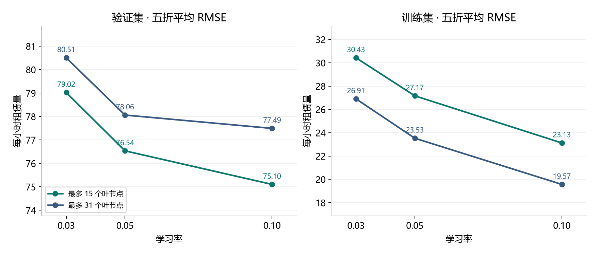
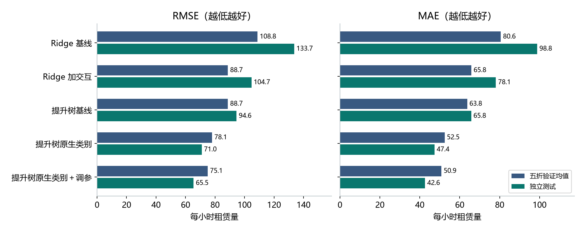
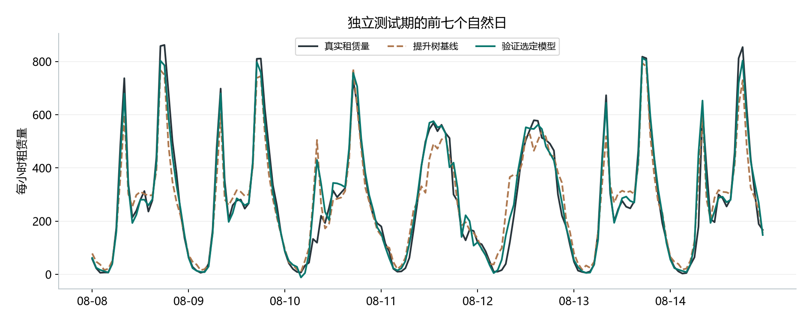

# C 阶段实验报告｜共享单车每小时租赁需求

**研究问题。** 第一，显式的“小时 × 工作日”交互和提升树原生类别分裂，能否改善对应基线？第二，在保持特征、损失和迭代轮数一致时，学习率与叶节点上限怎样影响时间验证误差？第三，由验证选择的方案能否在随后的独立时段保持优势？

## 数据与比较规则

数据为华盛顿特区 2011—2012 年的 UCI Bike Sharing 小时记录。目标为每小时租赁总量 `cnt`。开发集覆盖 2011-01-01 至 2012-08-07，共 13,915 条。测试集覆盖 2012-08-08 至 2012-12-31，共 3,464 条。全部划分以完整日期为单位，验证日在该折所有训练日之后。

四个数值输入为温度、体感温度、湿度和风速。八个类别输入为季节、年份、月份、小时、节假日、星期、工作日标记和天气类别。各折只用本折训练行拟合编码器、填充器与模型。日期用于排序、划分和追踪，两项直接相加等于目标的字段 `casual`、`registered` 已从特征中排除。

五折验证共覆盖相同的 11,608 条记录，最早的 2,307 条仅用于初始训练。模型选择以各折验证 RMSE 的等权算术平均为准。标准差取五折样本标准差。分组指标在相应记录上直接计算。独立测试指标在完整测试期一次计算。MAE 和 RMSE 的单位均为每小时租赁辆次，MSE 使用该单位的平方。

## 两项优化与网格设计

- **Ridge 加交互。** 工作日上午的通勤高峰和休息日的白天活动发生在不同小时。向原有独热类别中追加 `hr × 2 + workingday` 的组合类别，使同一时刻在两类日期具有不同的预测效应。数值特征继续标准化，正则系数、求解器保持一致。
- **提升树原生类别。** 对八个类别列在训练折内做众数填充与序数编码，并告知直方图梯度提升树哪些列为类别，使一次分裂可以组合多个类别。新类别映射为 NaN，由树处理；连续特征保留数值并以训练折中位数填充。
- **超参数实验。** 在原生类别流水线上交叉比较 3 个学习率和 2 个叶节点上限。共 6 个配置 × 5 折，实际完成 30 次拟合。v2 原始组合包含在网格内；它的五折边界及 MAE、RMSE、R² 均与归档复现结果核对一致。其余四个候选的既有验证记录直接复用。[原始复现记录](results/summary_metrics.csv) · [实验协议与源码指纹](c_stage/runs/pre_1109/search/protocol.json) · [基线参数快照](c_stage/runs/pre_1109/search/baseline.toml)

### 六组配置的敏感性

各项均为五折均值 ± 折间样本标准差，迭代轮数均为 200。

| 学习率 | 最多叶节点 | 训练 RMSE | 验证 MAE | 验证 RMSE | 验证 R² |
| ---: | ---: | ---: | ---: | ---: | ---: |
| 0.03 | 15 | 30.43 ± 8.39 | 53.52 ± 15.33 | 79.02 ± 21.35 | 0.733 ± 0.151 |
| 0.03 | 31 | 26.91 ± 7.24 | 54.50 ± 15.73 | 80.51 ± 22.24 | 0.725 ± 0.157 |
| 0.05 | 15 | 27.17 ± 7.84 | 51.40 ± 14.12 | 76.54 ± 19.51 | 0.747 ± 0.146 |
| 0.05 | 31（原始） | 23.53 ± 7.06 | 52.47 ± 15.51 | 78.06 ± 21.90 | 0.740 ± 0.154 |
| **0.10** | **15** | **23.13 ± 7.32** | **50.86 ± 14.21** | **75.10 ± 19.41** | **0.756 ± 0.142** |
| 0.10 | 31 | 19.57 ± 6.49 | 52.23 ± 15.70 | 77.49 ± 22.00 | 0.742 ± 0.155 |

三个学习率下，31 个叶节点均产生更低的训练误差和更高的验证误差，说明在本任务中继续增加单棵树容量有过拟合迹象。固定 15 个叶节点时，学习率从 0.03 提高到 0.05、0.10，验证 RMSE 依次从 79.02 降至 76.54、75.10。原始组合到最优组合平均下降 2.96（3.79%）。[30 条逐折指标](c_stage/runs/pre_1109/search/fold_metrics.csv) · [六组完整汇总](c_stage/runs/pre_1109/search/summary.csv)



## 选型及冻结

| 候选 | 五折验证 MAE | 五折验证 RMSE ↓ | 五折验证 R² |
| --- | ---: | ---: | ---: |
| v1 Ridge | 80.58 | 108.84 | 0.545 |
| v2 Ridge 加交互 | 65.84 | 88.73 | 0.693 |
| v1 提升树 | 63.76 | 88.71 | 0.685 |
| v2 提升树原生类别 | 52.47 | 78.06 | 0.740 |
| **v2 提升树原生类别＋调参** | **50.86** | **75.10** | **0.756** |

验证选定 `HistGradientBoostingRegressor`，输入为上述 12 列。采用平方误差、学习率 0.10、200 轮、最多 15 个叶节点、最大深度 6、叶节点至少 20 条、L2 为 1、最大分箱数 255，关闭早停，随机种子 42，线程上限 4。五个候选均使用原始连续预测，保留负值，不截断或取整。

北京时间 2026-11-07 21:48:05 写入冻结清单，随后才启动独立评价。清单包含五个候选的全部估计器参数、预处理、输入哈希、依赖版本和选型指标。独立评价记录保存了同一清单的 SHA-256。[五模型验证比较](c_stage/runs/pre_1109/freeze/candidate_cv.csv) · [冻结清单](c_stage/runs/pre_1109/freeze/selection.json) · [独立评价记录](c_stage/runs/pre_1109/test/evaluation.json)

## 独立测试与时间泛化

五个候选各自在完整开发集上重新拟合一次，并预测完全相同的 3,464 个测试小时。下表前四个指标均为独立测试成绩，末列为测试 RMSE 减去五折验证 RMSE 均值。

| 模型 | 测试 MAE | 测试 MSE | 测试 RMSE | 测试 R² | 测试与验证 RMSE 差 |
| --- | ---: | ---: | ---: | ---: | ---: |
| v1 Ridge | 98.80 | 17,878.06 | 133.71 | 0.6315 | +24.87 |
| Ridge 加交互 | 78.12 | 10,968.10 | 104.73 | 0.7739 | +16.00 |
| v1 提升树 | 65.76 | 8,947.93 | 94.59 | 0.8156 | +5.88 |
| 提升树原生类别 | 47.37 | 5,043.01 | 71.01 | 0.8960 | −7.05 |
| **提升树原生类别＋调参** | **42.63** | **4,289.70** | **65.50** | **0.9116** | **−9.61** |

测试期，调参相对原生类别基准将 RMSE 再降低 5.52（7.77%）；相对 v1 提升树，原生类别处理先降低 23.58，累计降低 29.10（30.76%）。Ridge 加交互使测试 RMSE 降低 28.98（21.67%）。各模型在验证和测试间的变化方向并不一致。重拟合使用了更多历史数据，且测试覆盖特定季节，两者均可能影响误差，本实验无法分解各自作用。本次测试后没有重新选型。[独立测试指标](c_stage/runs/pre_1109/test/metrics.csv) · [五方案的逐小时预测、真实值和残差](c_stage/runs/pre_1109/test/predictions.csv.gz)





首周图固定取 8 月 8 日至 14 日，横轴为小时。各模型指标使用整个留出时段，残差统一定义为预测值减去真实值。

## 分折与场景分析

| 验证折 | 验证区间 | 训练条数 | 原生类别验证 RMSE | 调参后训练 RMSE | 调参后验证 RMSE |
| ---: | --- | ---: | ---: | ---: | ---: |
| 1 | 2011-04-11 至 07-16 | 2,307 | 104.17 | 11.35 | 99.38 |
| 2 | 2011-07-17 至 10-21 | 4,634 | 55.09 | 21.36 | 54.92 |
| 3 | 2011-10-22 至 2012-01-26 | 6,945 | 64.35 | 25.32 | 65.50 |
| 4 | 2012-01-27 至 05-02 | 9,266 | 98.58 | 27.56 | 92.05 |
| 5 | 2012-05-03 至 08-07 | 11,587 | 68.12 | 30.05 | 63.67 |

调参后四折的 RMSE 下降，第 3 折从 64.35 增至 65.50。第一折训练历史最短，验证 RMSE 最高；第四折已有更多历史数据，误差仍升至 92.05。仅靠训练集大小无法解释折间差异。选定配置的平均训练 RMSE 为 23.13、平均验证 RMSE 为 75.10，说明拟合历史样本比预测未来时段容易。相同学习率下增加叶节点的受控对照，为模型容量影响泛化提供了更直接的证据。

分组沿用历史逐小时验证预测，并补入本轮选定配置的验证预测。组内 MAE 按对应样本数汇总。下表列出两个日期组和两个早高峰小时，工作日一列中 0 包括周末与节假日。[覆盖全部 24 小时及两类日期的分组指标](c_stage/runs/pre_1109/analysis/group_metrics.csv)

| 场景 | 验证条数 | 验证 MAE，Ridge → 加交互 | 测试条数 | 测试 MAE，提升树基线 → 原生类别 → 调参 |
| --- | ---: | ---: | ---: | ---: |
| 非工作日 | 3,630 | 93.67 → 68.80 | 1,127 | 73.35 → 54.84 → 49.23 |
| 工作日 | 7,978 | 74.67 → 64.54 | 2,337 | 62.09 → 43.77 → 39.45 |
| 早上 7 点 | 485 | 127.37 → 72.67 | 144 | 133.17 → 85.02 → 68.20 |
| 早上 8 点 | 485 | 192.30 → 100.77 | 144 | 137.13 → 100.53 → 85.74 |

Ridge 加交互在验证期非工作日的 MAE 降幅为 24.88，工作日为 10.13。对原生类别树进一步调参后，验证期早上 7 点和 8 点的 MAE 分别再降低 10.02 和 6.51，测试期相同小时的降幅为 16.82 和 14.79。改善没有覆盖全部小时，例如凌晨 4 点的测试 MAE 从 4.49 升到 5.62。

## 局限

只观察了一个城市和一个连续测试时段，历史天气特征在预测时被视为已知。扩展窗口的训练集相互重叠，折间标准差反映时段差异，不能当作置信区间。选择最优值与报告验证均值使用同一组五折，存在选型偏乐观的可能。最终结论限于六组网格和这段独立测试期。最终模型在测试期给出 43 个负预测，反映平方误差模型在低需求时的限制，评价遵守冻结的原始预测规则。

## 复现与验收

在仓库根目录进入 v2。运行环境复用 v1 的锁文件及 Python 3.12，本次实际使用 3.12.13、scikit-learn 1.9.1。下列 PowerShell 命令创建一个新的运行目录。搜索、冻结、测试和分析均保护已有阶段，重复运行时另取目录名。

```powershell
cd projects/regression-analysis/v2
uv sync --project ../v1 --locked
$run = "c_stage/runs/replay_01"
uv run --project ../v1 --locked python -m c_stage.experiment search $run
uv run --project ../v1 --locked python -m c_stage.experiment freeze $run
uv run --project ../v1 --locked python -m c_stage.experiment evaluate $run
uv run --project ../v1 --locked python -m c_stage.analysis $run --reference c_stage/runs/pre_1109/analysis/legacy_validation_groups.csv
uv run --project ../v1 --locked python -m pytest -q ../v1/tests c_stage/tests
uv run --project ../v1 --locked ruff check --config ../v1/pyproject.toml reproduce.py c_stage
uv run --project ../v1 --locked ruff format --config ../v1/pyproject.toml --check reproduce.py c_stage
```

正式运行使用本机已有的 v2 历史验证预测生成旧四方案的分组表。在含该预测文件的工作区，分析命令可省略 `--reference`；新检出仓库可直接复用交付的分组表。测试脚本对正式交付目录 `pre_1109` 做验收。完整测试共 21 项通过（v1 原有 15 项、C 新增 6 项），包括时间边界、折内编码、未见月份、六组验证预测、五组测试预测、指标独立复算及冻结顺序。在 v1 目录运行原项目 Ruff 检查和格式检查、在 v2 检查新增代码均通过。首次从 v2 跨目录调用 Ruff 对 v1 测试给出了 3 个导入排序提示；按 v1 项目自己的运行目录复核后全部通过，未改动 v1。

[实验及选型代码](c_stage/experiment.py) · [拓展分析与制图代码](c_stage/analysis.py) · [自动化验收](c_stage/tests/test_experiment.py) · [D 成员课堂摘要](C_pre_summary.md)

