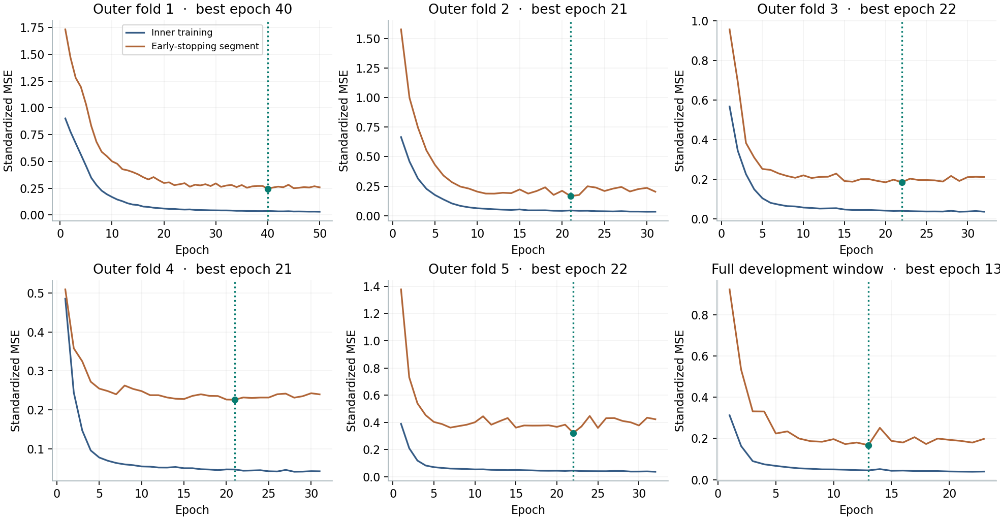
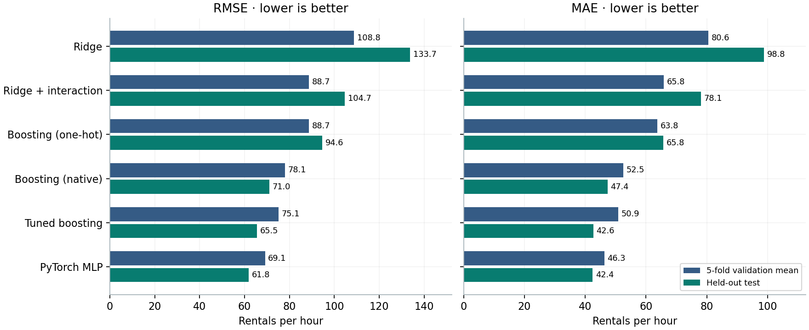
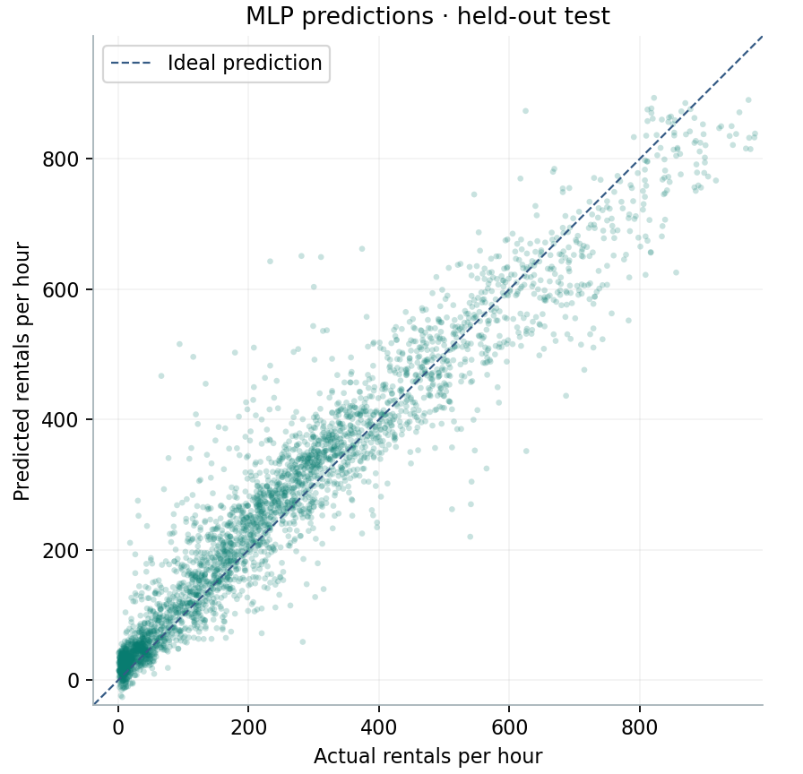
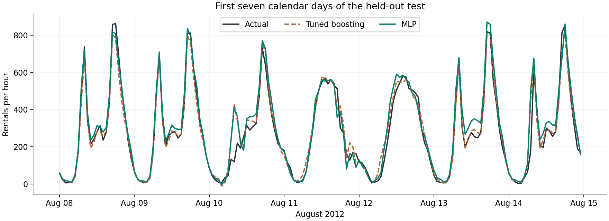

# v3 · PyTorch MLP 能否改善共享单车需求预测？

在相同的 11,608 条外层验证记录上，预设 MLP 的五折平均 RMSE 为 **69.13**，v2 调参提升树为 **75.10**。在随后 3,464 个测试小时上，两者 RMSE 分别为 **61.81** 和 **65.50**。测试 MAE 仅相差 **0.19 辆次/小时**。分组结果显示，MLP 在高需求时段减少了较大的误差，同时在低、中需求时段的平均绝对误差更高。

本实验在 v2 测试成绩公布之后开展。网络结构和训练规则在 v3 首次训练前写入冻结记录，整个实验只使用一个配置和随机种子。v2 正式选定的模型仍为原生类别调参提升树。[预设配置](configs/mlp.toml) · [冻结记录与实际环境](results/protocol/frozen.json)

## 数据、模型和早停

使用 UCI Bike Sharing 小时数据，共 17,379 行，预测目标为每小时租赁总量 `cnt`。直接调用 v1 的特征白名单、整日时间划分、预处理与评价函数。输入包括温度、体感温度、湿度、风速，以及季节、年份、月份、小时、节假日、星期、工作日、天气类别。日期用于划分和追踪，`casual`、`registered` 和标识列未参与建模。

- **预处理。** 数值列以训练数据中位数填充、标准化；类别列以众数填充、独热编码，遇到新类别时忽略。目标在相应训练数据上做 z-score 标准化。损失按标准化目标计算，预测逆变换回辆次后再评分。所有评分保留原始输出，包括测试中出现的 30 个负预测。
- **网络。** 以 `nn.Module` 构建输入 → 64 → 32 → 1 的全连接网络，两个隐藏层使用 ReLU，末层为线性输出。训练循环显式执行前向传播、MSELoss、反向传播和 Adam 更新。学习率 0.001，batch size 128，上限 100 个 epoch，种子 42。DataLoader 只在当前拟合子集内打乱小批次。
- **选轮数。** 在每个外层训练窗口内，把最后 15% 的完整日期（天数向上取整）留作内部早停段。仅在更早的部分拟合 X 和 y 的变换并训练，监控内部段 MSE，连续 10 轮未严格改善即停止，保存最低点权重。
- **全窗口重训。** 取得最佳轮数后，以相同种子重新初始化网络，在整个外层训练窗口重新拟合预处理器与目标变换，训练恰好该轮数，再评价未来的外层验证折。最终开发集也执行相同流程。内部最佳模型和全窗口重训模型分别保存，二者的输入维度可能随训练中出现的类别变化。[网络与训练循环](src/network.py) · [阶段编排及保存逻辑](src/experiment.py)

## 五折时间验证

开发集为 2011-01-01 至 2012-08-07 的 13,915 条记录。五折共用最初 2,307 条作为起始训练窗口，此后依时间扩展。下表的 MAE、RMSE、R² 均在外层验证折计算；“最佳/停止”两列来自各训练窗口内部的早停曲线。

| 折 | 重训条数 | 外层验证条数 | 最佳 / 停止 epoch | MLP MAE | MLP RMSE | MLP R² | v2 调参树 RMSE |
| ---: | ---: | ---: | ---: | ---: | ---: | ---: | ---: |
| 1 | 2,307 | 2,327 | 40 / 50 | 54.19 | 79.08 | 0.718 | 99.38 |
| 2 | 4,634 | 2,311 | 21 / 31 | 42.59 | 59.99 | 0.834 | 54.92 |
| 3 | 6,945 | 2,321 | 22 / 32 | 42.28 | 66.03 | 0.689 | 65.50 |
| 4 | 9,266 | 2,321 | 21 / 31 | 49.68 | 77.73 | 0.826 | 92.05 |
| 5 | 11,587 | 2,328 | 22 / 32 | 42.71 | 62.80 | 0.917 | 63.67 |

五折均值 ± 折间样本标准差为 MAE **46.29 ± 5.40**、MSE **4,839.67 ± 1,226.74**、RMSE **69.13 ± 8.75**、R² **0.797 ± 0.093**。MLP 在第 1、4 折领先较多，在第 2、3 折落后。日期窗口重叠，折间标准差不能当作模型差异的置信区间。[逐折指标与边界](results/validation/fold_metrics.csv) · [五折汇总](results/validation/summary.csv) · [验证逐条预测](results/validation/predictions.csv.gz)



六次内部训练均触发 patience。完整开发集先用 11,803 条记录拟合，随后 2,112 条监控早停。第 13 轮内部 MSE 达到最低 **0.1676**，第 23 轮为 **0.1978**；同期训练 MSE 继续从 **0.0452** 降至 **0.0395**。后期存在对拟合子集继续适应的迹象。早停规则选回了第 13 轮，本实验没有设置固定 100 轮的外部对照，无法估计早停对独立测试的净收益。[最终早停曲线](results/final_model/early_stopping.csv) · [全开发集重训记录](results/final_model/training.json)

## 与经典模型的统一比较

每个经典模型的成绩从 v2 归档表直接读取。以逐行 ID、日期、小时、工作日和真实需求核对 MLP 与冻结提升树的验证预测和测试预测；验证期同时核对折号。验证列使用五个折各自指标的算术平均，测试列使用 2012-08-08 至 2012-12-31 全部测试记录一次计算。

| 模型 | 验证 MAE | 验证 RMSE | 验证 R² | 测试 MAE | 测试 RMSE | 测试 R² |
| --- | ---: | ---: | ---: | ---: | ---: | ---: |
| v1 Ridge | 80.58 | 108.84 | 0.545 | 98.80 | 133.71 | 0.6315 |
| v2 Ridge 加交互 | 65.84 | 88.73 | 0.693 | 78.12 | 104.73 | 0.7739 |
| v1 提升树 | 63.76 | 88.71 | 0.685 | 65.76 | 94.59 | 0.8156 |
| v2 原生类别提升树 | 52.47 | 78.06 | 0.740 | 47.37 | 71.01 | 0.8960 |
| v2 原生类别调参提升树 | 50.86 | 75.10 | 0.756 | 42.63 | 65.50 | 0.9116 |
| **v3 PyTorch MLP** | **46.29** | **69.13** | **0.797** | **42.44** | **61.81** | **0.9212** |

最终 MLP 在完整 13,915 条开发记录上重训 13 轮。保存权重和变换器后重新加载，输出测试预测，得到 **MSE 3,820.39**。相对 v2 调参提升树，MLP 的验证 RMSE 下降 7.96%，测试 RMSE 下降 5.63%，测试 MAE 下降 0.44%。[汇总表](results/analysis/model_comparison.csv) · [归档来源及行对齐记录](results/analysis/comparison_sources.json) · [独立测试指标](results/test/metrics.json) · [逐小时预测与残差](results/test/predictions.csv.gz)



## 需求水平与泛化

分组阈值取全部开发集真实需求的第 25、75 百分位，即 37、258 辆次/小时。只在评分后按真实值分组，这两个阈值不参与模型输入、选轮数或预测。

| 测试需求组 | 小时数 | MLP MAE | 调参树 MAE | MLP RMSE | 调参树 RMSE |
| --- | ---: | ---: | ---: | ---: | ---: |
| 低，≤37 | 717 | 20.33 | 12.29 | 29.49 | 27.28 |
| 中，38–258 | 1,347 | 44.51 | 38.05 | 65.98 | 60.13 |
| 高，>258 | 1,400 | 51.77 | 62.57 | 69.41 | 82.18 |

高需求时段，MLP 的平均残差（预测减真实）为 **−2.33**，调参树为 **−50.45**，后者在这组平均低估较多。低、中需求时段则是 MLP 平均高估更多，解释了两种模型在总体 RMSE 上拉开距离、MAE 却接近的现象。开发集外层验证的高需求组也有相同方向，MLP 和调参树的 RMSE 分别为 106.13、122.77；低需求组的胜负随时段变化。[两阶段、三组需求的完整误差](results/analysis/demand_bands.csv)





加性 Ridge 需要显式构造交互，MLP 的隐藏层能够从同一组小时、日历和天气输入中学习非线性组合，树则按特征分裂建立分段预测。三种表达方式与观测的性能差异相容；本次比较还涉及优化方式、类别编码和正则化，无法把优势单独归因于网络结构。对这个规模的表格数据，小型 MLP 是有竞争力的补充，特别是在重视高需求大误差时。只有一个城市、一个种子和一段已经用于 v2 的历史测试期，不能据此推断跨城市、跨种子或后续年份的普遍排名。

## 环境、复现和模型文件

正式实验复用本机已有的 `D:\Anaconda3\envs\macr_cif\python.exe`，Python 3.10.20、PyTorch 2.11.0+cu128、scikit-learn 1.7.1。机器有 RTX 4060 Laptop GPU，正式训练固定使用单线程 CPU 和确定性算法。v1/v2 的归档成绩沿用其原运行环境；v3 直接导入同一份数据、预处理和指标源码。使用现有环境时无需重新安装 PyTorch。

在 v3 目录运行以下 PowerShell 命令。重新运行时指定一个新的目录，已有阶段会被保护。

```powershell
$py = 'D:\Anaconda3\envs\macr_cif\python.exe'
$run = 'replays/run01'
& $py -B src/experiment.py --output $run
& $py -B src/analysis.py --output $run
& $py -B -m pytest -q
```

另附 Windows x64 的 [pyproject.toml](pyproject.toml) 与 [uv.lock](uv.lock)，用于独立重建环境。需要新装时可用 `uv sync --locked --python 3.10`，然后把上述 Python 路径换为 `.venv\Scripts\python.exe`。本次实际训练使用已有 Conda 环境，锁文件已通过一致性检查。

- 每个外层折在 `results/validation/fold_1` 至 `fold_5` 保存内部最佳权重及配套变换器、全窗口权重及配套变换器、早停与重训曲线。
- 最终部署/回放用 [全开发集权重](results/final_model/refit.pt) 与[配套特征和目标变换器](results/final_model/refit_transforms.joblib)；按 `src/experiment.py` 的 `restore` 加载后，用 `src/network.py` 的 `predict` 输出原始单位预测。
- [验收测试](tests/test_mlp.py)覆盖模型层次、冻结顺序、各折预处理与目标变换、最佳权重与内部最低损失、归档权重逐行回放、原始单位指标独立复算、分组和对照来源。正式结果的 4 项集成测试全部通过，Ruff 静态与格式检查通过。四张 PNG 均已验证。
